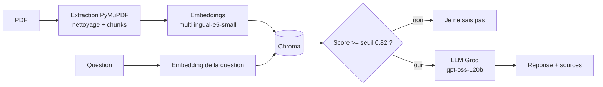

# Assistant RAG en français (ENIAD)

Application qui répond à des questions en français sur un ensemble de documents (règlement de l'ENIAD, cours d'Agile et de Deep Learning). Chaque réponse indique ses sources (fichier et page), et l'assistant répond « Je ne sais pas » quand l'information n'est pas dans les documents.

Projet réalisé dans le cadre de mon PFE (ENIAD) : RAG, embeddings multilingues, base vectorielle, API FastAPI, agent avec tool calling, puis conteneurisation et déploiement cloud.

**Avancement :** ingestion, recherche, génération, évaluation, API et agent terminés. Docker, CI et déploiement Google Cloud Run : à venir. Lien public : à venir.

## Fonctionnement



Deux garde-fous contre les réponses inventées : un seuil de similarité (aucun appel au LLM si aucun passage n'est assez proche) et une consigne au LLM de refuser si les passages ne contiennent pas la réponse.

## Résultats d'évaluation

Évaluation automatique : 15 questions avec réponse (éléments attendus + bonne source citée) et 5 questions sans réponse dans les documents (refus attendu).

| Mesure | Résultat |
|---|---|
| Seuil de départ (0.85), 20 questions | 18/20 |
| Seuil retenu (0.82), 20 questions de réglage | 20/20 |
| Seuil retenu (0.82), 10 questions neuves jamais utilisées pour le réglage | 9/10 |
| Refus corrects sur les questions sans réponse (30 questions) | 10/10 |

Le seuil de 0.82 a été choisi à partir des 20 premières questions : le 20/20 est donc optimiste. Le chiffre le plus fiable est **9/10 sur les questions neuves**. Détails et diagnostics par question : [`evaluation/results.md`](evaluation/results.md), et comparaison des seuils dans `evaluation/results_seuil_*.md`.

Limites de l'évaluation : petit échantillon, questions écrites par moi, notation par mots-clés (peut rejeter une réponse correcte formulée autrement). L'agent n'est pas encore évalué.

## API

| Méthode | Route | Rôle |
|---|---|---|
| GET | `/health` | État du service, taille de l'index |
| POST | `/ask` | Question -> réponse, sources, score |
| POST | `/agent` | Agent à deux outils (recherche dans les documents, calculatrice) |

Documentation interactive : `http://127.0.0.1:8000/docs`.

## Lancer en local

Prérequis : Python 3.11 ou plus, une clé API [Groq](https://console.groq.com/keys).

```powershell
python -m venv .venv
.\.venv\Scripts\Activate.ps1
pip install -r requirements.txt
Copy-Item .env.example .env        # puis renseigner GROQ_API_KEY
```

Les documents ne sont pas publiés dans ce dépôt (règlement et cours : droits de diffusion). Place tes propres PDF (avec texte sélectionnable) dans `data/pdfs/`, puis :

```powershell
python src/ingest.py               # extraction et chunks
python -m src.embed                # embeddings et index Chroma
uvicorn src.api:app --port 8000    # API
pytest -v                          # tests
python -m src.evaluate             # évaluation (nécessite questions.json adapté à tes documents)
```

## Choix techniques

- **PyMuPDF** plutôt que pypdf : pypdf collait des mots (« Réseauxde ») sur mes PDF.
- **multilingual-e5-small** : multilingue, contexte de 512 tokens, léger. `paraphrase-multilingual-MiniLM` tronque à 128 tokens ; `bge-m3` est trop lourd pour un niveau gratuit.
- **Chroma** : base embarquée sans serveur, suffisante pour quelques centaines de passages.
- **Calculatrice de l'agent** : analyse syntaxique avec liste blanche d'opérateurs, jamais `eval` sur du texte venant du LLM.
- **Modèle LLM configurable** (`GROQ_MODEL`) : les modèles Llama que j'utilisais sur Groq ont été arrêtés en août 2026.

## Limites connues

- **Les sources indiquent le fichier et la page.** Les citations reformulées par le LLM ne sont pas garanties exactes au caractère près : elles servent à retrouver le passage, pas à le recopier.
- Les tableaux des PDF sont aplatis, les schémas et formules en image ne sont pas extraits, pas d'OCR.
- La recherche sémantique ne sait pas restreindre une question à un document précis (piste : filtre sur la métadonnée `source`).
- Corpus de 6 documents : les résultats ne se généralisent pas à un autre corpus.

## Structure

```
src/        ingest.py, embed.py, search.py, rag.py, evaluate.py, agent.py, api.py
tests/      tests unitaires (aucun appel réseau)
evaluation/ questions, résultats et comparaisons de seuils
NOTES.md    journal de développement et décisions
```

## À venir

Dockerfile et docker-compose, intégration continue (GitHub Actions), déploiement sur Google Cloud Run avec la clé API dans Secret Manager, lien public.